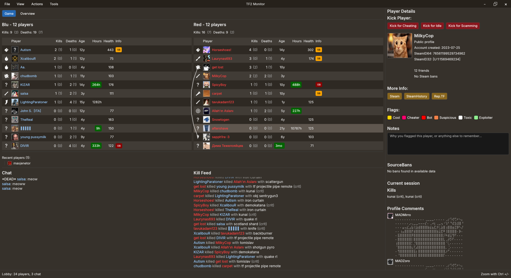
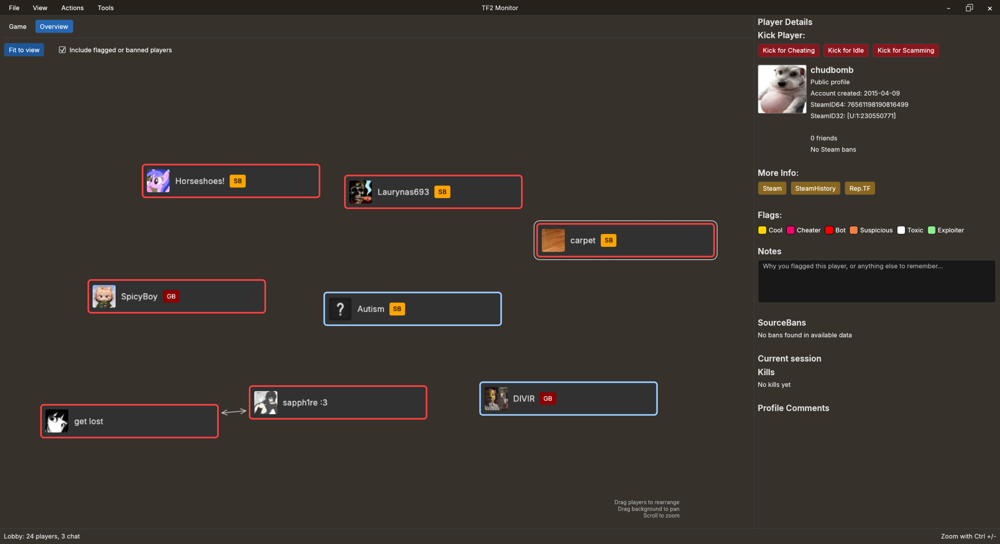

# TF2Monitor

[](https://discord.gg/z9Cn7m3gdN)

An application to be run along when you are playing Team Fortress 2.

- View public info about the players you play with:
- Mark players with flags (Cheater, Bot, Suspicious, etc.) and save them to `playerlist.json`
- Automatically votekick cheaters and bots (configurable in settings)

# Screenshot

## Scoreboard tab



## Overview tab



# Getting Started

There are pre-compiled binaries you can use, but you can compile TF2Monitor yourself if you like. The pre-compiled binaries can be found here: https://github.com/aftershavetf2/TF2Monitor/releases

## Configuration

1. Start Steam. If Steam is running your SteamID is read from the Windows registry if you are on Windows. For Linux you have to manually set it in the settings.json after it has been created.

2. _IMPORTANT_: First start will complain about a missing `settings.json` file, and a skeleton settings file was created.

3. Quit TF2Monitor and open that `settings.json` in a text editor.

4. Fill in your own SteamID, if you are on Windows and Steam was running, it is filled in already.

5. Fill in the SteamAPI key, go to https://steamcommunity.com/dev/apikey to create a personal one. This is needed to fetch information from Steam Community. It is optional but nice.

6. Start TF2Monitor again

## How to Compile TF2Monitor

To compile it yourself you need to [install Rust](https://www.rust-lang.org/tools/install). Rust 1.95 or newer is required; use the current stable toolchain (`rustup update stable`).

After that you go to the folder where this `README.md` file is located with a command line/terminal prompt and type `cargo run --release` and the application will be compiled and started.

## Configure TF2

Add these launch options to TF2:

```
-usercon +developer 1 +contimes 0 +ip 0.0.0.0 +net_start +sv_rcon_whitelist_address 127.0.0.1 +rcon_password rconpwd +hostport 40434 +net_start +con_timestamp 1 -condebug -conclearlog -g15 
```

## Common Problems

### No `tf/console.log` file?

It seems TF2 doesn't automatically create the log file these days. You have to enter this command in the TF2 console window:

```
+con_logfile "console.log" 
```

# What about VAC?

This application does not:

- Alter any game file, or any other file at all

- Intervene with the TF2 process and memory in any way. No DLL injection or anything like that.

- It doesn't draw anything onto the TF2 screen

This is completely VAC safe.

All it does is:

- Start TF2 with some flags to tell it to log more info to the `console.log` file, and enable and configure RCON(remote connect) so this app can send commands to TF2.

- Then the application periodically reads from the `console.log` file

- Sends commands to TF2 over RCON telling it to log info about the players in the server, to votekick cheaters and bots.

# Privacy Statement

This application does not collect any personal information about you. It does not contain any analytics or anything like that.

It fetches player account information from Steam Community and community ban snapshots from GitHub Releases. Community ban lookups for your current TF2 session run locally.

The full source code is available for anyone to inspect.

# Linux and Windows support

This app has been developed on both Linux and Windows and works great on both.

# Other projects of interest

There are already several similar applications like this one. Some of them has been tested for years and offers a lot of functionality.

- https://botdetector.tf/

  - Newly developed.
  - Uses a Go backend.
  - Uses a web frontend written in React.

- https://github.com/PazerOP/tf2_bot_detector

  - This is archived and not developed.
  - With some tweaks it still works fine.
  - Has a lot of features.
  - Written in C++ with a Dear Imgui frontend.
  - Windows only AFAIK.
  - There are also forks with fixes and updates:
    - https://github.com/surepy/tf2_bot_detector

# Publish a release from VS Code

With Python 3 and Git available, commit the changes you want to release and open the repository in VS Code.
Run **Tasks: Run Task** from the Command Palette and choose **Release: Bump patch and publish**.
The task bumps the patch version in `Cargo.toml` and `Cargo.lock`, commits it, and pushes the current branch and matching `v<version>` tag to `origin`.
The Rust (Windows) workflow runs the tests, builds the Windows ZIP, and publishes it to GitHub Releases.

If the push fails after the version commit, rerun the task after resolving the Git error to retry the same version.
If the tag was pushed and the build failed, rerun the workflow in GitHub Actions.
